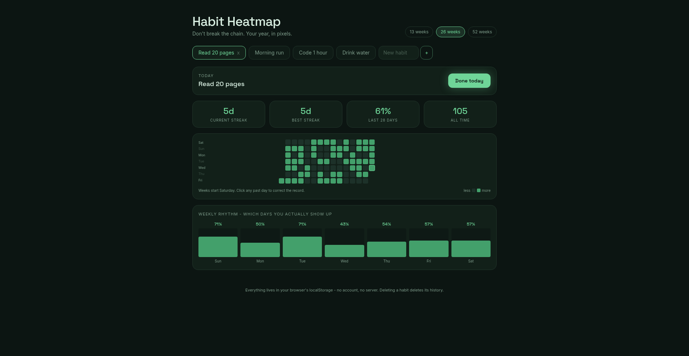

# Habit Heatmap

A GitHub-style habit tracker tuned for an Egyptian week: the heatmap starts on Saturday, streaks and a weekly-rhythm chart show when you actually show up, and any past day can be corrected with a click. No account, no server - everything lives in localStorage.

**Live demo:** https://malakmo7amed309.github.io/habit-heatmap/



## Standout feature

The honest history. Most habit apps only let you check today; here every past cell is editable (missed a day? forgot to log? click it), streaks recompute instantly, and the **weekly rhythm** chart answers a question streaks can't: which weekdays do you actually keep this habit? Weeks start on Saturday to match the Egyptian rhythm, and the whole thing works offline with zero signup.

## What's inside

- Multiple habits with add/delete, each with its own heatmap
- One-tap daily check-in, current/best streaks, 28-day rate, all-time count
- 13 / 26 / 52 week heatmap views, Saturday-start weeks, today highlighted
- Weekly rhythm: completion percentage per weekday across the visible window
- Seeds a believable demo history on first visit so the map tells a story immediately (clears as you track your own)

## Stack

React 19, Tailwind CSS 4, Vite (single-file build, no backend). Heatmap and charts are hand-rolled - no chart library.

## Run locally

```bash
npm install
npm run dev
```

Build outputs a single self-contained `dist/index.html` (what GitHub Pages serves from `docs/`).
